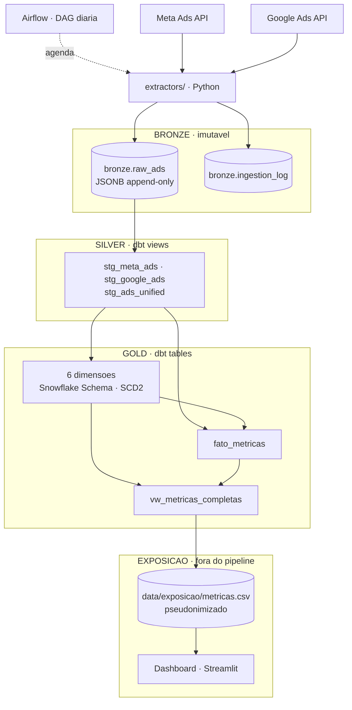

# Pipeline de Dados — Marketing Digital


Pipeline **ELT** containerizado que extrai metricas diarias de campanhas do **Meta Ads** e **Google Ads**, preserva o dado bruto em **PostgreSQL**, o transforma em um modelo dimensional unificado com **dbt** e agenda a execucao diaria com **Apache Airflow**. Projetado como trabalho de conclusao de curso (TCC) em Engenharia de Dados.

---

## Arquitetura

Pipeline **ELT em camadas** (bronze → silver → gold). A extracao entrega o
payload da API sem transformar; toda transformacao acontece no banco,
materializada e testada pelo dbt. A exposicao (dashboard e qualquer material
publico) fica fora do pipeline e consome apenas uma superficie pseudonimizada.



O `main.py` orquestra extracao → carga bronze → `dbt build` (transformacao +
testes). Se qualquer etapa falhar, o pipeline interrompe com exit code 1. Em
operacao, a DAG `pipeline_marketing_diario` do Airflow executa as mesmas
etapas como tasks separadas (`extrai_meta`, `extrai_google`, `carrega_bronze`,
`transforma_dbt`), todo dia as 06:00 (America/Sao_Paulo).

Detalhes de projeto, validacao e limitacoes em
[`docs/arquitetura-elt.md`](docs/arquitetura-elt.md) e
[`airflow/README.md`](airflow/README.md).

---

## Features

| Feature | Descricao |
|---|---|
| **Arquitetura em camadas** | Bronze (JSONB bruto, append-only) → Silver (limpeza e unificacao) → Gold (modelo dimensional) |
| **Orquestracao** | DAG diaria no Airflow 3.3, uma task por etapa (falha isolada e retry seletivo), janela movel dos 7 dias completos anteriores |
| **Idempotencia** | Reprocessar o mesmo periodo nao altera o resultado da gold; a bronze acumula snapshots e a silver mantem o mais recente |
| **Historico (SCD Tipo 2)** | Renomeacoes de conta, campanha, adset e anuncio viram versoes; o fato resolve a versao vigente pela data |
| **Testes de dados** | 79 testes de dados e 31 testes unitarios no dbt (o `dbt build` reporta PASS=121: 11 modelos + 79 + 31), alem de 985 testes Python (`unittest`) |
| **Paridade** | Golden snapshot dos agregados: refatoracao que muda numero falha em `scripts/verificar_paridade.py`, sem tolerancia numerica |
| **Rastreabilidade** | Dado bruto preservado permite reprocessar todas as camadas sem chamar a API novamente |
| **Observabilidade** | `bronze.ingestion_log` registra lote, fonte, periodo e volume de cada carga; um manifesto (fonte, run, janela, sha256) prova a origem de cada JSON bruto |
| **Backfill historico** | Argumento `--start-date` / `--end-date` permite carga retroativa de qualquer periodo |
| **Snowflake Schema** | 5 dimensoes normalizadas em cadeia (Plataforma -> Conta -> Campanha -> AdSet -> Anuncio) + dim_tempo + 1 tabela fato |
| **Multi-plataforma** | Meta Ads (Insights API com paginacao) e Google Ads (GAQL) unificados em schema comum |
| **Metricas** | 9 metricas base, valor de compra e o Result oficial do Meta (tipo, quantidade, janela de atribuicao e custo) |
| **Fronteira de exposicao** | Dashboard e material publico saem de um CSV pseudonimizado por HMAC, com contrato fail closed e auditor independente |
| **Dashboard** | Streamlit + Plotly, com classificacao relativa de desempenho de campanhas e anuncios |
| **Benchmark** | PostgreSQL x DuckDB medido de 10 mil a 10 milhoes de linhas ([`benchmark/README.md`](benchmark/README.md)) |
| **DevSecOps** | Container non-root, mascaramento de logs (`mask()`), validacao fail-fast de env vars, zero SQL injection |

---

## Modelo de Dados

Schema `gold`, materializado pelo dbt. Dimensoes da hierarquia versionadas em
**SCD Tipo 2** — duas chaves por entidade:

```
<ent>_nk   chave natural     md5 da cadeia hierarquica, estavel entre renomeacoes
<ent>_sk   chave substituta  md5(nk + versao), uma por versao

dim_plataforma → dim_conta → dim_campanha → dim_adset → dim_anuncio
                                                              |
dim_tempo -------------------------------------------→ fato_metricas
                                                   grao: 1 anuncio x 1 dia

Metricas (9):    spend | impressions | link_clicks | conversions
                 conversion_value | video_views | reach
                 profile_views | purchases
Valor de compra: purchase_value
Result (Meta):   result_type | result_count
                 result_attribution_window | cost_per_result
Contexto (Meta): objective | optimization_goal
```

> Para consultar, use `gold.vw_metricas_completas`: a view atravessa as cinco
> dimensoes resolvendo a versao vigente de cada uma
> (`data BETWEEN valido_de AND valido_ate`), no mesmo grao do fato. Juntar uma
> dimensao SCD2 pela chave natural sem resolver a versao vira 1:N e infla os
> agregados. Ver [`docs/der.md`](docs/der.md) e
> [`docs/queries_demo.sql`](docs/queries_demo.sql).

O Google nao fornece `reach`, `profile_views` e `purchases` nesse nivel da GAQL
(ficam zerados), e `video_views` tem definicao diferente em cada plataforma:
compare dentro da plataforma, nunca somado entre elas.

---

## Pre-requisitos

- [Docker](https://docs.docker.com/get-docker/) e [Docker Compose](https://docs.docker.com/compose/install/)
- Credenciais de API do **Meta Ads** (App ID, App Secret, Access Token, Business ID)
- Credenciais de API do **Google Ads** (Developer Token, Client ID/Secret, Refresh Token, Login Customer ID)

O Data Warehouse sobe junto com o projeto (PostgreSQL 16 em container), entao
nao e necessario nenhum banco externo. Para carregar num Postgres gerenciado
(ex: [Supabase](https://supabase.com/)), basta apontar `DW_DB_URL` para ele.

O dashboard em modo demonstracao dispensa credencial, `.env` e banco.

---

## Como Rodar

### 1. Clonar o repositorio

```bash
git clone https://github.com/pedropaulo-d/pipeline_marketing.git
cd pipeline_marketing
```

### 2. Configurar variaveis de ambiente

```bash
cp .env_template .env
# Preencha as credenciais das APIs no .env. PSEUDONIMIZACAO_CHAVE so e
# necessaria para gerar a superficie de exposicao (secao 5.1).
```

### 3. Subir o Data Warehouse

```bash
docker compose up -d db
```

Nao ha DDL de inicializacao: o schema nasce do proprio pipeline — o
`bronze_loader` aplica o DDL da bronze e o dbt materializa silver e gold.
O banco fica exposto em `localhost:5433` (usuario `etl`, senha `etl`,
database `marketing_dw`).

### 4. Executar o pipeline

```bash
# Pipeline completo — extrai o dia anterior (D-1)
docker compose run --rm etl_app python main.py

# Backfill — carga historica de um periodo especifico
docker compose run --rm etl_app python main.py --start-date 2026-03-01 --end-date 2026-03-31

# Apenas uma plataforma (util quando as credenciais da outra estao indisponiveis)
docker compose run --rm etl_app python main.py --platforms meta

# Reprocessar os dados brutos ja extraidos, sem consumir a API
docker compose run --rm etl_app python main.py --skip-extract
```

### 4.1. Transformacoes e testes isolados

```bash
# Materializa silver e gold e roda os testes (PASS=121: 11 modelos,
# 79 testes de dados e 31 testes unitarios)
docker compose run --rm -e DBT_PROFILES_DIR=/app/dbt -w /app/dbt etl_app dbt build

# Apenas os testes
docker compose run --rm -e DBT_PROFILES_DIR=/app/dbt -w /app/dbt etl_app dbt test

# Documentacao navegavel com grafo de lineage
docker compose run --rm -e DBT_PROFILES_DIR=/app/dbt -w /app/dbt etl_app dbt docs generate
```

No Git Bash (Windows), prefixe os comandos com `-w /app/dbt` com
`MSYS_NO_PATHCONV=1`; sem isso o caminho vira `C:/Program Files/Git/app/dbt`.

### 4.2. Testes Python e paridade

```bash
# Testes unitarios (os do grafo da DAG so rodam onde o Airflow existe)
docker compose run --rm etl_app python -m unittest discover -s tests -t .

# Compara os agregados do DW com o golden snapshot; sai com 1 se divergir
docker compose run --rm etl_app python scripts/verificar_paridade.py verificar

# Dados brutos sinteticos no formato das duas APIs (em tests/fixtures/)
docker compose run --rm etl_app python scripts/gerar_fixture.py
```

O golden em `tests/golden/` descreve o armazem do autor: a verificacao de
paridade so faz sentido sobre o mesmo conjunto de dados.

### 5. Consultar o Data Warehouse

```bash
# Queries analiticas de demonstracao (inclui a prova de idempotencia)
docker exec -i tcc_dw psql -U etl -d marketing_dw < docs/queries_demo.sql

# Sessao interativa
docker exec -it tcc_dw psql -U etl -d marketing_dw
```

### 5.1. Dashboard analitico (camada de visualizacao)

Painel em Streamlit + Plotly. Consome **exclusivamente** a superficie de
exposicao pseudonimizada — nunca a bronze, a silver, a gold, o banco ou as
APIs.

```bash
# Modo demonstracao: funciona num clone limpo, sem .env, banco ou credencial.
docker compose up -d dashboard          # http://localhost:8501

# Modo pseudonimizado: gere a superficie de exposicao antes.
docker compose run --rm etl_app python scripts/exportar_dataset_exposicao.py
docker compose run --rm etl_app python scripts/auditar_dataset_exposicao.py
docker compose up -d dashboard
```

Com `data/exposicao/metricas.csv` presente o painel o adota sozinho e exibe o
selo `DADOS PSEUDONIMIZADOS`; sem ele, cai no dataset sintetico versionado em
`dashboard/dados_demo/` e exibe `DADOS DE DEMONSTRACAO`. Nao ha fallback para
banco.

Quatro paginas: Visao Geral, Campanhas, Anuncios e Sobre os dados. Campanhas e
Anuncios trazem a classificacao relativa de desempenho. Detalhes em
[`dashboard/README.md`](dashboard/README.md).

### 5.2. Orquestracao com Airflow

```bash
docker compose up -d airflow-apiserver airflow-scheduler airflow-dag-processor
# UI em http://localhost:8082 (admin/admin)

docker exec tcc_airflow_scheduler airflow dags list-import-errors
```

A DAG `pipeline_marketing_diario` nasce pausada. Despausada, roda todo dia as
06:00 (America/Sao_Paulo) sobre a janela movel `[D-7, D-1]`: as metricas do
Meta mudam retroativamente por ate 28 dias, entao extrair so o dia anterior
congelaria numeros que ainda vao mudar. Um disparo manual pode informar
`data_inicial` e `data_final` (os dois) para outra janela. Detalhes em
[`airflow/README.md`](airflow/README.md).

### 5.3. Benchmark PostgreSQL x DuckDB

```bash
docker compose run --rm etl_app python benchmark/gerar_dados.py
docker compose run --rm etl_app python benchmark/executar.py --escalas 10k 1M
```

No volume projetado (menos de 600 mil linhas em 5 anos) o pior caso do
PostgreSQL fica abaixo de 400 ms, e ele vence a busca pontual em todas as
escalas. Resultados e metodologia em [`benchmark/README.md`](benchmark/README.md).

### 6. Execucao de modulos individuais (opcional)

```bash
# Apenas extracao
docker compose run --rm etl_app python extractors/meta_ads.py --start-date 2026-03-30 --end-date 2026-03-31

# Apenas a carga do bruto na bronze
docker compose run --rm etl_app python loaders/bronze_loader.py
```

---

## Estrutura do Projeto

```
pipeline_marketing/
|-- config.py                  # Env vars, logging, mascaramento, conexao do dbt
|-- plataformas.py             # Registro unico das plataformas suportadas
|-- janela.py                  # Janela movel: os 7 dias completos anteriores
|-- manifesto.py               # Prova de origem do JSON bruto (fonte, run, janela)
|-- pseudonimos.py             # Primitivo unico de pseudonimizacao (HMAC-SHA256)
|-- main.py                    # Orquestrador: extracao -> bronze -> dbt build
|-- Dockerfile                 # Python 3.11-slim, usuario non-root (UID 1000)
|-- docker-compose.yml         # DW, etl_app, Airflow e dashboard
|-- pyproject.toml             # Torna o projeto importavel (install editavel)
|-- requirements.txt           # Dependencias Python (inclui dbt-postgres)
|
|-- extractors/
|   |-- comum.py               # Casca comum: salvar bruto, laco de contas, CLI
|   |-- meta_ads.py            # Extrator Meta Ads (Insights API + paginacao)
|   |-- google_ads.py          # Extrator Google Ads (GAQL)
|
|-- loaders/
|   |-- bronze_loader.py       # Carga do JSON bruto na bronze
|
|-- sql/bronze/
|   |-- init_bronze.sql        # DDL da camada bronze + log de ingestao
|
|-- dbt/
|   |-- dbt_project.yml
|   |-- profiles.yml
|   |-- macros/                # SCD2, ultimo snapshot, Result do Meta, chaves consumidas
|   |-- models/
|   |   |-- silver/            # stg_meta_ads, stg_google_ads, stg_ads_unified
|   |   |-- gold/              # 6 dimensoes + fato_metricas + vw_metricas_completas
|   |-- tests/                 # testes singulares (grao, SCD2, regressao entre lotes)
|
|-- airflow/
|   |-- Dockerfile             # Airflow 3.3.0 com as dependencias do projeto
|   |-- dags/pipeline_marketing_diario.py
|   |-- README.md              # Decisoes da DAG
|
|-- scripts/
|   |-- verificar_paridade.py  # Golden snapshot dos agregados
|   |-- gerar_fixture.py       # Dados brutos sinteticos das duas APIs
|   |-- exportar_dataset_exposicao.py  # Gold -> superficie pseudonimizada
|   |-- auditar_dataset_exposicao.py   # Auditor independente do artefato
|   |-- anonimizar_dataset.py  # JSON bruto -> versao desidentificada
|   |-- generate_google_refresh_token.py
|   |-- oauth_manual.py        # Fluxo OAuth manual em dois passos
|   |-- _env_utils.py          # Leitura e gravacao de credenciais no .env
|
|-- tests/                     # Testes Python (unittest), fixtures e golden
|
|-- benchmark/                 # Experimento PostgreSQL x DuckDB e resultados
|
|-- .streamlit/
|   |-- config.toml            # Tema do painel
|
|-- dashboard/                 # Camada de visualizacao (Streamlit + Plotly)
|   |-- app.py                 # Quatro paginas: geral, campanhas, anuncios, dados
|   |-- dados.py               # Contrato fail closed do CSV de exposicao
|   |-- metricas.py            # Catalogo das metricas, derivadas, divisao segura
|   |-- classificacao.py       # Classificacao relativa de desempenho
|   |-- filtros.py             # Filtros globais com hierarquia
|   |-- graficos.py            # Figuras Plotly
|   |-- gerar_dados_demo.py    # Dataset sintetico versionado
|   |-- Dockerfile             # Imagem sem driver de banco e sem SDK
|
|-- docs/
    |-- arquitetura-elt.md     # Projeto das camadas e validacao de paridade
    |-- der.md                 # Diagrama entidade-relacionamento
    |-- queries_demo.sql       # Queries analiticas de demonstracao
    |-- notas-para-documentacao-tcc.md  # Insumo para a monografia
    |-- plano-refatoracao.md   # Plano da refatoracao guiada por paridade
    |-- reuniao-orientador.md  # Material de orientacao academica
    |-- tcc/                   # Metodologia, snapshot experimental e dashboard
```

---

## Seguranca

Este projeto passou por uma auditoria de seguranca (DevSecOps) cobrindo:

- **Credenciais nos logs**: todos os IDs sensiveis mascarados via `config.mask()`; tracebacks sanitizados para nao expor tokens
- **SQL Injection**: 100% das queries usam bind parameters via SQLAlchemy; zero concatenacao de strings em SQL
- **Validacao de ambiente**: `config.validate_env()` verifica no startup, com fail-fast, as 9 credenciais de API e a URL do banco
- **Container hardening**: Dockerfile executa como usuario non-root (`etl`, UID 1000); `.dockerignore` impede que `.env` e `.git` entrem na imagem
- **Repositorio**: `.gitignore` exclui `.env`, os JSON brutos das APIs e os datasets gerados em `data/`
- **Pseudonimizacao**: nomes e IDs viram rotulos HMAC-SHA256 com chave local fora do repositorio; sem salt no codigo e sem mapa persistente
- **Fronteira de exposicao**: o dashboard so le a superficie pseudonimizada; a imagem dele nao instala driver de banco nem SDK de plataforma, o servico nao recebe `.env` e o dataset entra somente leitura

---

## Stack Tecnica

| Camada | Tecnologia |
|---|---|
| Linguagem | Python 3.11 |
| Container | Docker / Docker Compose |
| Extracao | facebook-business SDK, google-ads SDK |
| Carga do bruto | SQLAlchemy + psycopg2-binary |
| Transformacao | dbt-postgres (silver e gold no banco) |
| Banco | PostgreSQL 16 |
| Orquestracao | Apache Airflow 3.3.0 (LocalExecutor) |
| Visualizacao | Streamlit + Plotly (servico proprio, sem credencial) |
| Benchmark | DuckDB |
| Seguranca | python-dotenv, config.py (mask + validate_env), HMAC-SHA256 |

---

## Licenca

Este projeto e distribuido sob a licenca MIT. Consulte o arquivo `LICENSE` para mais detalhes.
