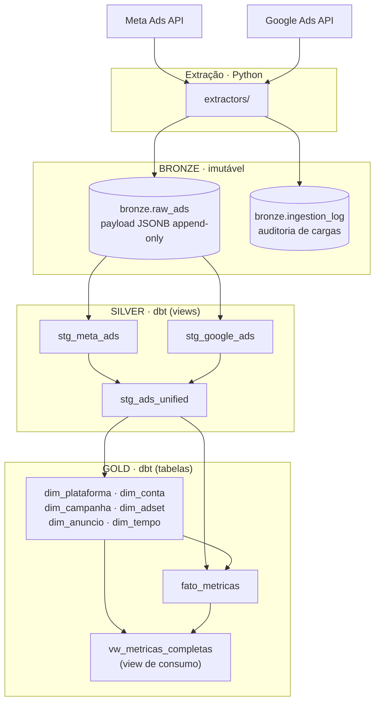

# Arquitetura ELT — bronze → silver → gold

Implementada em 05/08/2026. Conviveu com o pipeline ETL original até 06/08,
quando o caminho legado foi removido e o projeto passou a ter uma arquitetura
só. As medições de paridade desta nota foram feitas enquanto os dois
coexistiam; o código do ETL permanece no histórico do git e pode ser
restaurado pelo commit, resolvido pela mensagem (o SHA muda quando o histórico
é sanitizado):

```bash
ETL=$(git log --all -1 --format=%H --grep='documenta arquitetura, demonstracao')
git checkout "$ETL" -- transformers/ loaders/supabase_loader.py init_db.sql
```

Revisada em 19/10/2026 para o estado final: deduplicação por entidade (desde
25/08), view de consumo, Result oficial do Meta, orquestração pelo Airflow e
contagens do snapshot de 31/08/2026. As medições datadas de agosto ficam como
registro histórico.

## Por que mudou

O ETL anterior gravava o dado bruto em arquivos temporários que **eram
sobrescritos a cada execução**. Consequência prática: descobrir um erro de
transformação exigia re-extrair da API. E API pode não estar disponível — o
acesso ao Google Ads ficou indisponível por meses neste projeto, o que quase
custou o dado de abril.

Na arquitetura em camadas o bruto é preservado, e todas as transformações
podem ser refeitas a partir dele sem tocar na fonte.

## O fluxo



O `main.py` executa a sequência numa chamada. Em operação, a DAG
`pipeline_marketing_diario` do Airflow roda as mesmas etapas como tasks
separadas (`extrai_meta`, `extrai_google`, `carrega_bronze`,
`transforma_dbt`), todo dia às 06:00, sobre os 7 dias completos anteriores —
ver [`airflow/README.md`](../airflow/README.md). A exposição (dashboard e
material de Defesa) fica fora do pipeline: lê a view, pseudonimiza na
fronteira e grava `data/exposicao/metricas.csv` — ver
[`dashboard/README.md`](../dashboard/README.md).

## O que cada camada faz

### Bronze — `bronze.raw_ads`

Payload exatamente como a API devolveu, em `JSONB`, com metadados de
ingestão: `source`, `reference_date`, `extracted_at`, `batch_id`.

**É append-only.** Reprocessar o mesmo dia não sobrescreve: cria um lote novo.
Isso preserva o histórico das respostas da API e habilita uma análise que o
modelo anterior tornava impossível — medir a **deriva retroativa** das
métricas. A janela de atribuição do Meta revisa conversões por até 28 dias,
então o mesmo dia extraído em momentos diferentes traz números diferentes.
Com a bronze append-only, essa diferença fica registrada e é mensurável.

A tabela `bronze.ingestion_log` registra cada carga (lote, fonte, período,
volume, momento) — base de observabilidade que o pipeline não tinha.

### Silver — limpeza e unificação

Três views:

| Modelo | Responsabilidade |
|---|---|
| `stg_meta_ads` | Tipagem + desempacotamento de `actions`/`action_values` e do Result oficial |
| `stg_google_ads` | Tipagem + alinhamento de nomenclatura ao vocabulário comum |
| `stg_ads_unified` | União das plataformas + surrogate keys encadeadas |

**Deduplicação:** como a bronze acumula snapshots, a silver mantém a última
observação de cada entidade em cada dia: `dense_rank()` particionado pela data
de referência e pela chave natural hierárquica (conta / campanha / adset ou
grupo de anúncios / anúncio), ordenado por `extracted_at desc`. Entidade
presente num lote posterior recebe a métrica revisada; entidade ausente
conserva a última observação — ausência não é zero. A regra mora numa macro
única para as duas fontes (`ultimo_snapshot`), e nome e métrica nunca
participam da deduplicação.

Até 24/08/2026 a partição era só `(source, reference_date)`: o lote mais
recente substituía o dia inteiro, e um lote parcial apagava entidades
ausentes. Ver [`tcc/snapshot-experimental-final.md`](tcc/snapshot-experimental-final.md).

### Gold — modelo dimensional

O mesmo Snowflake Schema de antes, agora materializado por dbt: 6 dimensões
em hierarquia encadeada mais a tabela fato, com grão de um anúncio por dia.
Além das 9 métricas, o fato guarda `purchase_value` e o Result oficial do Meta
(tipo, quantidade, janela de atribuição e custo), com `objective` e
`optimization_goal` como contexto. Colunas e semântica em [`der.md`](der.md).

A consulta passa pela view `gold.vw_metricas_completas`, que atravessa as
cinco dimensões com a cláusula de validade em cada nível, no mesmo grão do
fato.

**Dimensões versionadas em SCD Tipo 2.** Cada entidade tem duas chaves:

| Chave | Papel |
|---|---|
| `<ent>_nk` | Chave natural — `md5` da cadeia hierárquica, estável entre renomeações |
| `<ent>_sk` | Chave substituta — `md5(nk + versão)`, única por versão |

Os níveis se referenciam pela chave **natural** do pai, de modo que criar uma
nova versão de uma campanha não force novas versões em todos os seus anúncios.

A tabela fato aponta para a **versão vigente na data da métrica**, resolvida
por `join` na chave natural filtrado pelo intervalo de validade — o *surrogate
key pipeline* de Kimball. Os intervalos são contíguos por construção
(`valido_ate` = véspera do início da próxima versão; a última vai até
`9999-12-31`), então toda linha do fato encontra exatamente uma versão.

#### De onde vem o histórico

Da bronze. Como ela é append-only, o nome observado em cada extração fica
registrado. Isso é essencial porque **a API não permite reconstruir esse
histórico**: consultada hoje, ela devolve o nome atual mesmo para datas
passadas.

A consequência metodológica precisa estar no texto: o versionamento reflete
**o que foi observado no momento da extração**, não o estado real da
plataforma naquele dia. É uma aproximação — a única possível sem *change data
capture* na origem — e ela subestima renomeações ocorridas entre duas
extrações.

#### Demonstração

Três campanhas foram renomeadas entre abril e agosto nos dados reais.

⚠️ **Nomes e identificadores abaixo são pseudônimos documentais.** Os valores
reais carregam marca do cliente, razão social e o `external_id` da plataforma —
identificadores diretos que não podem constar de arquivo versionado. O que está
preservado é a estrutura do nome e a natureza da mudança, que é o que a
demonstração precisa. Estes rótulos são exemplo de documentação; não têm relação
com os pseudônimos do dataset de exposição, que vêm de HMAC com chave local.
A mesma convenção é usada na seção 5.4 de `notas-para-documentacao-tcc.md`.

| # | `external_id` | v1 (07/04 – 31/07) | v2 (01/08 – atual) | O que mudou |
|---|---|---|---|---|
| A | `EXTERNAL_ID_A` | `[MARCA_A] [OBJETIVO] [CANAL] DD/MM/AAAA` | `[MARCA_A] [OBJETIVO] [CANAL] AAMMDD` | formato da data embutida |
| B | `EXTERNAL_ID_B` | `[FORMATO] [SECAO] DD/MM/AA` | `[OBJETIVO] [SECAO] [FORMATO] - DD/MM/AA` | vocabulário e ordem dos tokens |
| C | `EXTERNAL_ID_C` | `[MARCA_C] EMPRESA_C_GRAFIA_1 DD-MM` | `[MARCA_C] EMPRESA_C_GRAFIA_2 DD-MM` | correção de erro de digitação |

O `external_id` é o mesmo nas duas versões — é ele que ancora a chave natural e
faz as duas linhas da dimensão descreverem a **mesma** entidade. O caso C mostra
que basta corrigir um erro de digitação para nascer uma versão nova: a dimensão
registra a mudança observada, não julga se ela é semanticamente relevante.

Consultando o investimento por dia, cada data exibe o nome vigente à época —
o relatório de abril não é mais reescrito pela renomeação de agosto.

Em 06/08, `dim_campanha` tem 183 linhas para 180 entidades; `dim_adset`, 340
para 337; `dim_conta`, 58 para 57. A diferença são exatamente as versões.

No snapshot final (31/08/2026), as versões extras são 11: `dim_conta` tem 67
linhas para 65 entidades, `dim_campanha` 222 para 217, `dim_adset` 450 para
446 e `dim_anuncio` 910 para 910.

Três testes garantem a consistência do versionamento:
`assert_scd2_sem_sobreposicao` (intervalos não se sobrepõem, o que duplicaria
métricas no join), `assert_scd2_uma_versao_atual` (exatamente uma versão
corrente por entidade) e `assert_join_dimensional_nao_infla` (a travessia da
hierarquia devolve exatamente uma linha por linha do fato).

> [!warning] O versionamento muda o contrato de consulta
> Juntar o fato à dimensão pela chave natural **sem** a cláusula de validade
> transforma o `join` em 1:N e infla os agregados sem produzir erro algum. Com
> apenas 3 entidades renomeadas, o investimento total sobe 7,8% — de
> R$ 20.216,73 para R$ 21.795,17. O erro já contaminou a tabela de resultados
> consolidados do trabalho, corrigida em 06/08. Toda consulta ao armazém passa
> a ter a obrigação de declarar em que instante do tempo está olhando.

## O que se ganhou e o que se perdeu

| | ETL anterior | ELT atual |
|---|---|---|
| Reprocessar sem API | ❌ | ✅ |
| Histórico do dado bruto | ❌ | ✅ append-only |
| Testes de dados | ❌ | ✅ 79 testes de dados + 31 unitários |
| Histórico de renomeações | ❌ SCD Tipo 1 | ✅ SCD Tipo 2 |
| Lineage documentado | ❌ | ✅ gerado pelo dbt |
| Auditoria de execuções | ❌ | ✅ `ingestion_log` |
| Integridade referencial | FKs do banco | testes `relationships` |

> A perda das foreign keys é o custo real da migração. No ETL a integridade
> era imposta pelo PostgreSQL, que rejeitava a escrita inválida. No dbt ela é
> **verificada após a materialização** pelos testes `relationships`. É uma
> garantia mais fraca em natureza — detecta em vez de impedir — mas cobre os
> mesmos relacionamentos e roda a cada execução do `dbt build`.

## Validação: paridade com o ETL

O ELT foi validado contra o ETL sobre os mesmos 1.672 registros. Resultado:

| Métrica | Confere? |
|---|---|
| Linhas por dia e plataforma | ✅ idêntico |
| `spend` | ✅ idêntico |
| `impressions`, `link_clicks` | ✅ idêntico |
| `conversion_value`, `reach`, `video_views` | ✅ idêntico |
| `conversions` | ⚠️ divergência intencional |

**A divergência em `conversions` é uma correção, não um erro.** O Google Ads
reporta conversões **fracionadas** — uma conversão pode ser creditada
parcialmente a vários anúncios pela modelagem de atribuição. O ETL convertia
cada linha com `int()`, que trunca. Somando as 1.672 linhas:

- ETL: **376** conversões (truncado linha a linha)
- ELT: **380,29** conversões (valor real da API)

O modelo antigo descartava silenciosamente ~1% das conversões do Google. A
coluna passou a ser `NUMERIC` na gold.

> [!note] Achado metodológico
> Esse erro só apareceu porque a migração foi validada por paridade em vez de
> ser aceita por "os testes passaram". Os 65 testes do dbt passavam com o
> pipeline produzindo números errados — um bug de ordem de colunas no
> `union all`, que casa colunas por posição e não por nome, trocava
> `reach`, `conversions` e `conversion_value` do Google entre si.
> Testes de schema não pegam erro de conteúdo.

### Depois da remoção do ETL: golden de paridade

Sem o ETL para comparar, a referência passou a ser um golden snapshot dos
agregados do armazém (`tests/golden/`). `scripts/verificar_paridade.py
verificar` compara o estado atual com ele e sai com 1 se algo divergir. As
coleções com chave natural são comparadas por chave, e não há tolerância
numérica: arredondar antes de comparar esconderia exatamente o tipo de erro
descrito acima. Toda refatoração de transformação passa por essa verificação.

## Como rodar

```bash
# Pipeline completo: extração, carga na bronze e dbt build
docker compose run --rm etl_app python main.py

# Reprocessar sem consumir a API
docker compose run --rm etl_app python main.py --skip-extract

# Só as transformações e testes
docker compose run --rm -e DBT_PROFILES_DIR=/app/dbt -w /app/dbt etl_app dbt build

# Documentação navegável com o grafo de lineage
docker compose run --rm -e DBT_PROFILES_DIR=/app/dbt -w /app/dbt etl_app dbt docs generate

# Paridade com o golden
docker compose run --rm etl_app python scripts/verificar_paridade.py verificar
```

## Limitações que permanecem

- **SCD Tipo 2 limitado pela granularidade da extração** — só detecta
  renomeações entre extrações, não no instante em que ocorrem.
- **Materialização full-refresh** — a gold é reconstruída inteira a cada
  execução. Adequado ao volume do snapshot final (11.326 linhas no fato; a
  projeção fica abaixo de 600 mil em 5 anos); exigiria modelos incrementais em
  outra ordem de grandeza.
- **Cobertura desigual de métricas** — `reach`, `profile_views`, `purchases` e
  `purchase_value` continuam zerados para o Google, por limitação da consulta
  GAQL nesse nível. O Result oficial e o contexto de campanha (`objective`,
  `optimization_goal`) existem só no Meta; no Google ficam nulos.
  `video_views` deixou de ser zero em 06/08, mas com uma ressalva: o valor vem
  de `metrics.video_trueview_views`, que conta visualização de 30 segundos,
  vídeo completo ou interação — enquanto o Meta conta a partir de 3 segundos.
  A coluna é comum, a definição não. Comparar as duas plataformas nessa métrica
  não tem significado; a série de cada uma isoladamente tem.
- **Filtro por status atual em consulta histórica** — corrigido em 06/08, mas
  vale como lição registrada. A GAQL filtrava `campaign.status = 'ENABLED'`,
  comparando o status de hoje com métricas de um dia passado. Reextrair um
  período perdia as campanhas pausadas desde então e, como a silver adota o
  snapshot mais recente, o gasto já carregado era apagado do DW. O teste
  `assert_reextracao_nao_perde_gasto` passou a vigiar essa classe de perda.
